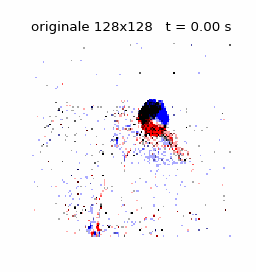
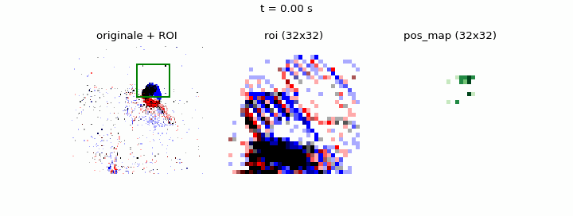

# DVSGesture ROI Challenge

Obiettivo: trovare la rete migliore per classificare gli 11 gesti di **DVSGesture**
(camera a eventi, sensore 128x128) usando una **regione di interesse (ROI)** che segue
il gesto e la sua **posizione** sul sensore. Come combinare le due informazioni
fa parte della challenge.

**Obiettivi**, in ordine di priorità:

1. **accuracy** sul test il più alta possibile, con una rete di **meno di 300k
   parametri**;
2. **FLOPs** il più bassi possibile: a parità di accuracy vince la rete con meno FLOPs.
3. **Params** il più basso possibile: a parità di accuracy e FLOPs vince la rete con meno parametri.

**NOTA BENE**: per *parità di accuracy* si intente stessa accuratezza con un $\pm5\%$.

I FLOPs si contano per **un frame** (la rete classifica un frame alla volta), cioè per
un passaggio in avanti con un ingresso, con `evaluate.count_flops` (Keras o PyTorch),
che usa le stesse regole del nostro tuner:

| layer | FLOPs |
|-------|-------|
| Conv1D / Conv2D, Dense / Linear | 2 per moltiplicazione-somma (MAC) + 1 per uscita (bias) |
| MaxPooling / AveragePooling | dimensione della finestra per ogni elemento in uscita |
| GlobalAveragePooling | 1 per elemento in ingresso (GlobalMaxPooling: 0) |
| somma di tensori (Add) | 1 per elemento |
| softmax | 5 per elemento |
| attivazioni, batch normalization, dropout, flatten, concatenazione | 0 |

Per i parametri usate `evaluate.count_params` (conta anche quelli non allenabili, es.
le statistiche della batch normalization).

## Il dataset

Le registrazioni originali sono flussi di eventi di una camera a eventi 128x128: ogni
evento dice che un pixel ha cambiato luminosità in un certo istante, con una polarità
(aumento o diminuzione). Per ridurre i dati, di ogni registrazione si tiene solo una
**finestra 32x32 (la ROI)** che si sposta seguendo il gesto. Avete quindi due
informazioni separate:

- **che cosa succede dentro la ROI**: gli eventi della finestra 32x32;
- **dove si trova la ROI** nel frame originale 128x128, istante per istante.

Nessuna delle due da sola è il frame originale: sta a voi decidere come usarle e
come combinarle nella rete.

Una registrazione originale (gesto *left hand wave*, frame da 50 ms; rosso e blu sono
le due polarità):



La stessa registrazione come la ricevete voi: a sinistra l'originale con la ROI
(riquadro verde), al centro `roi`, cioè cosa succede dentro il riquadro, a destra
`pos_map`, cioè dove si trova il riquadro:



Per ogni registrazione avete:

| campo        | shape            | contenuto |
|--------------|------------------|-----------|
| `roi`        | `[T, 32, 32, 2]` | frame di eventi dentro la ROI; i 2 canali sono le due polarità, il valore è il numero di eventi del pixel in quel frame |
| `pos_map`    | `[T, 32, 32, 1]` | posizione della ROI come immagine: il frame 128x128 ridotto a 32x32, che si "accende" nei punti in cui si trovava il centro della ROI durante quel frame |
| `pos_events` | lista di N array | eventi di posizione grezzi (vedi sotto) |
| `y`          | intero           | classe del gesto, 0..10 (vedi `data.CLASS_NAMES`) |
| `user`       | intero           | persona che ha eseguito il gesto: utenti 1..23 nel train, 24..29 nel test |

`roi` e `pos_map` sono già allineati: il frame `k` di entrambi copre lo stesso
intervallo di tempo.

### Eventi di posizione grezzi (`pos_events`)

Per chi vuole costruire una rappresentazione della posizione diversa da `pos_map`
(coordinate, traiettorie, velocità, ...). Ogni registrazione è un array strutturato
numpy con un evento ogni 1 ms:

| campo | significato |
|-------|-------------|
| `t`   | istante in microsecondi dall'inizio della registrazione |
| `x`, `y` | centro della ROI nel frame originale 128x128, in pixel (0..127): la ROI copre circa i pixel da `x - 16` a `x + 15` e da `y - 16` a `y + 15`, e può uscire in parte dal bordo del sensore |
| `s`   | dimensione della ROI: 32. Vale 1 solo nei primissimi eventi di alcune registrazioni (con `x = y = 16`), quando la ROI non è ancora stata individuata: questi eventi vanno ignorati |
| `p`   | sempre `False`, non contiene informazione |

Se usate `pos_events`, l'allineamento con i frame di `roi` è a vostro carico: i frame
partono dal primo evento ROI della registrazione e coprono al massimo le sue prime 1.5 s
(vedi il protocollo sotto).

## Protocollo

Ogni registrazione è una sequenza di `T` frame. 
La rete può classificare un frame alla volta o blocchi di frame e la predizione sulla registrazione è la media delle probabilità dei suoi frame, o dei suoi blocchi di frame (soft majority vote).
Attenzione che più frame alla volta significa rete più profonda e quindi più grande! Si tratta di trovare il miglior compromesso; è importatne anche considerare che ogni esempio ha due canali, uno per polarità positiva (la luce sul sensore aumenta) e uno per polarità negative (la luce diminuisce).
Le polarità possono essere mantenute entrambe come canali separati (il più informativo e che generalmente da i migliori risultati), ma è possibile anche tenere una polarità sola, o ad esempio sottrarle per ridurre la dimensionalità. A voi la scelta.

Di ogni registrazione si usano solo le **prime 1.5 s** (le registrazioni più corte
vengono scartate). Come dividerle in frame lo scegliete voi, ma **train e test devono
usare lo stesso raggruppamento**:

- **a tempo fisso** (default): `framing="delta_t"`, frame da `delta_t` microsecondi
  (default `200_000`, cioè 200 ms → `T = 7` frame). Potete scegliere un altro `delta_t`.
  Ogni registrazione ha lo stesso numero di frame e `roi` / `pos_map` sono array
  `[N, T, ...]`.
- **a numero di eventi**: `framing="events"`, ogni frame contiene `n_events` eventi
  della ROI (default `2000`; l'ultimo frame contiene gli eventi rimanenti, quindi può
  averne meno). `pos_map`
  è accumulata sugli stessi intervalli di tempo, quindi resta allineata a `roi`.
  Il numero di frame cambia da registrazione a registrazione: `roi` e `pos_map`
  sono liste di `N` array `[T_i, ...]`.

```python
train, test = data.load_dataset()                                     # 200 ms
train, test = data.load_dataset(framing="delta_t", delta_t=100_000)   # 100 ms
train, test = data.load_dataset(framing="events", n_events=1000)      # 1000 eventi per frame
```

Per avere risultati confrontabili **non cambiate la metrica**: la rete deve dare una
predizione per ogni frame di ogni registrazione di test e l'accuracy si calcola con
`evaluate.accuracy`, su tutte le registrazioni di test.
Per il resto potete fare quello che volete (augmentation, normalizzazioni, ...).

### Validation e test

Gli utenti del test (24..29) non compaiono mai nel train: la rete deve generalizzare
a persone nuove. La validation deve fare lo stesso, quindi è divisa **per utente**:
`data.train_val_split(train)` mette in validation le registrazioni degli utenti
7, 12, 14 e 18 (gli stessi usati dal nostro tuner, ~150 registrazioni) e lascia le
altre nel train. Potete scegliere altri utenti con `val_users=`, ma mai dividere le
registrazioni dello stesso utente tra train e validation.

**Il test si usa solo per la valutazione finale**: early stopping, scelta degli
iperparametri e scelta del modello vanno fatti sulla validation. Un modello scelto
guardando il test ha un'accuracy di test ottimistica e non confrontabile.

## Regole sulla rete

- Solo layer **convolutivi** (Conv1D / Conv2D) e **fully connected** (Dense). Sono
  ammessi i layer di supporto: pooling, batch normalization, dropout, flatten e
  concatenazione. **Niente RNN** (LSTM, GRU, ...) **né transformer / attention.**
- Funzioni di attivazione: solo **ReLU** ed **ELU** (più la softmax finale per avere
  le probabilità delle classi).
- **Meno di 300k parametri** in totale (tutti i rami della rete inclusi).

## Consigli di training

- **Mescolate i dati a ogni epoca.** Le registrazioni sono ordinate per utente
  (cartelle `userXX_...`): senza shuffle ogni batch contiene pochi utenti e la rete
  generalizza peggio. Con la rete per frame potete mescolare sia le
  registrazioni sia i singoli frame.
- **La posizione spaziale conta.** Il gesto dipende da *dove* avviene il movimento
  (nella ROI e nella `pos_map`). Un `GlobalAveragePooling2D` alla fine delle
  convoluzioni fa la media su tutta la mappa e perde questa informazione: sulla
  rete di esempio qui sotto scende da ~0.85 a ~0.65. Meglio un `Flatten`, che però
  costa molti parametri nel layer Dense successivo (8x8x32 = 2048 ingressi). Per
  ridurli senza perdere la posizione:
  - un **pooling in più prima del `Flatten`** (mappa 4x4: 1/4 dei parametri);
  - una **convoluzione 1x1** che riduce i canali (es. 32 → 8) mantenendo la mappa
    8x8: il costo del Dense non cresce più con il numero di filtri.

  Sulla rete di esempio entrambe danno la stessa accuracy del `Flatten` semplice con
  ~3.5 volte meno parametri.
- Fate più run con seed diversi: con 264 registrazioni di test una registrazione vale
  0.4 punti e tra un seed e l'altro ci sono facilmente 1-2 punti di differenza.

## Rete di esempio

Un punto di partenza piccolo (è la rete da cui parte anche il nostro tuner): la
`pos_map` come canale in più (esempio 1 sotto), frame da 200 ms.

```
ingresso [32, 32, 3]  (roi + pos_map)
Conv2D 16, 3x3, ReLU -> MaxPool 2x2       -> [16, 16, 16]
Conv2D 32, 3x3, ReLU -> MaxPool 2x2       -> [8, 8, 32]
MaxPool 2x2 -> Flatten                    -> 512
Dense 64, ReLU -> Dense 11, softmax
```

~38.6k parametri; con Adam (lr 1e-3), batch da 16 registrazioni (7 frame ciascuna)
e shuffle arriva a circa **0.85** di accuracy sul test dopo 20-40 epoche. In Keras:

```python
model = tf.keras.Sequential([
    tf.keras.layers.Input((32, 32, 3)),
    tf.keras.layers.Conv2D(16, 3, padding="same", activation="relu"),
    tf.keras.layers.MaxPooling2D(),
    tf.keras.layers.Conv2D(32, 3, padding="same", activation="relu"),
    tf.keras.layers.MaxPooling2D(),
    tf.keras.layers.MaxPooling2D(),
    tf.keras.layers.Flatten(),
    tf.keras.layers.Dense(64, activation="relu"),
    tf.keras.layers.Dense(11, activation="softmax"),
])
```

## Esempi di combinazione ROI + posizione

Sono le varianti provate da noi con il Symbolic DNN-Tuner. Servono come spunto: potete
migliorarle o inventarne altre.

**1. Mappa di posizione come canale in più**.
`pos_map` viene concatenata a `roi` lungo i canali: un solo ingresso `[32, 32, 3]`
per frame, elaborato da una CNN 2D.

```python
x = np.concatenate([d["roi"], d["pos_map"]], axis=-1)   # [N, T, 32, 32, 3]
```

**2. Coordinate come secondo ingresso**.
Per ogni frame si calcola il centro di massa `(y, x)` di `pos_map` (2 numeri). La CNN
2D lavora solo su `roi`; le sue feature (dopo il flatten) vengono concatenate alle
2 coordinate e passate ai layer fully connected.

```
roi [32,32,2] -> Conv2D ... -> Flatten --\
                                          Concatenate -> Dense ... -> softmax
pos (y, x)  [2] -------------------------/
```

**3. Traiettoria della ROI con Conv1D**.
Ogni frame da 200 ms viene diviso in `K = 8` sotto-finestre da 25 ms. La CNN 2D riceve
`roi` sommata sulle 8 sotto-finestre (`[32, 32, 2]`); il secondo ingresso è la
traiettoria della ROI nel frame, cioè le coordinate `(y, x)` di ogni sotto-finestra
normalizzate in [0, 1] (`[8, 2]`; se una sotto-finestra non ha eventi di posizione si
ripete l'ultima posizione valida). La traiettoria passa da un piccolo ramo Conv1D, poi
le feature dei due rami vengono concatenate prima dei layer fully connected.

**4. Sotto-finestre come canali**.
Come nel 3, ogni frame è diviso in `K = 8` sotto-finestre, ma tutto finisce in un solo
ingresso `[32, 32, 2K + 1] = [32, 32, 17]`: le 8 `roi` delle sotto-finestre (2
polarità ciascuna) più la `pos_map` sommata sul frame come ultimo canale.

Per 3 e 4 le sotto-finestre si ottengono caricando i dati (train e test) con frame da
25 ms e raggruppandoli a 8 a 8: 7 gruppi da 8 = 7 frame da 200 ms.

```python
K = 8
d = data.load_split("train", framing="delta_t", delta_t=200_000 // K)  # T = 60 frame da 25 ms
roi_sub = d["roi"][:, :7 * K].reshape(-1, 7, K, 32, 32, 2)             # [N, 7, 8, 32, 32, 2]
map_sub = d["pos_map"][:, :7 * K].reshape(-1, 7, K, 32, 32, 1)         # [N, 7, 8, 32, 32, 1]
```

## Setup

```bash
pip install -r requirements.txt
```

Serve la cartella `DVSGestureROI_fs32/` (con `train/` e `test/`) dentro
`./rois_and_coordinates/datasets`, oppure passate il percorso con `root=`.
La prima volta la conversione in frame richiede alcuni minuti; poi gli array sono
salvati in `./cache/challenge/*.npz` e ricaricati subito.

Il framework per la rete è libero (PyTorch, TensorFlow, ...): `data.py` e
`evaluate.py` usano solo numpy e tonic.

## Uso

```python
import data, evaluate

train, test = data.load_dataset()
train["roi"].shape       # (N, 7, 32, 32, 2)   frame da 200 ms
train["pos_map"].shape   # (N, 7, 32, 32, 1)
train["pos_events"][0]   # eventi di posizione della prima registrazione
train["y"].shape         # (N,)
train["user"].shape      # (N,)  utente di ogni registrazione

# validation: split per utente (utenti 7, 12, 14, 18; mai lo stesso utente in train e val)
tr, va = data.train_val_split(train)

# ... la vostra rete ...

# valutazione: probabilità per frame sulle registrazioni di test, nello stesso ordine
# di data.load_split("test"): array [N, T, 11], o lista di N array [T_i, 11] con
# framing="events"
acc = evaluate.accuracy(frame_probs, test["y"])

# parametri e FLOPs per frame
evaluate.count_params(model)
evaluate.count_flops(model)                                # Keras
evaluate.count_flops(model, input_shape=(3, 32, 32))       # PyTorch: shape di un frame, canali prima
evaluate.count_flops(model, input_shape=[(2, 32, 32), (2,)])  # PyTorch con due ingressi: forward(x, pos)
```

Con PyTorch vengono contati solo i layer `nn.Module` (usate `nn.Softmax`,
`nn.MaxPool2d`, ... invece delle versioni funzionali; una somma `x + y` nel `forward`
non viene contata).

## Cosa consegnare

Il codice della rete (incluso come combinate ROI e posizione), l'accuracy sul test
ottenuta con `evaluate.accuracy`, il numero di parametri e i FLOPs per frame del
modello.

## File

- `data.py` – caricamento del dataset (stesso preprocessing del Symbolic DNN-Tuner)
- `evaluate.py` – metrica ufficiale, conteggio di parametri e FLOPs
- `img/` – le animazioni di questo README
